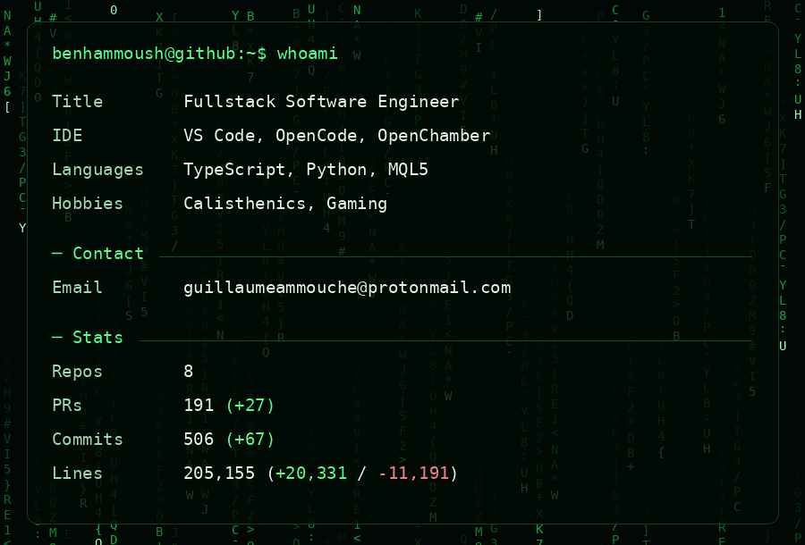

[Email me](mailto:guillaumeammouche@protonmail.com) · [Static version](assets/profile.png) · [How the stats work](DEVELOPMENT.md#counting-rules)

Text version

- **Title:** Fullstack Software Engineer
- **IDE:** VS Code, OpenCode, OpenChamber
- **Languages:** TypeScript, Python, MQL5
- **Hobbies:** Calisthenics, Gaming
- **Email:** [guillaumeammouche@protonmail.com](mailto:guillaumeammouche@protonmail.com)

Public statistics are available in [stats.json](assets/stats.json).

